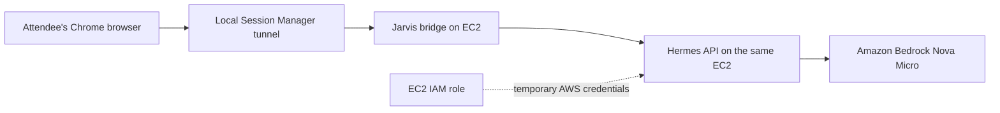

# Run this as an event

## What attendees should leave with

Each attendee can open their own private Jarvis page, hold Space to ask a simple question, hear Hermes answer through Bedrock, reconnect later, and delete the stack. This is a conversation workshop; avoid demonstrations that imply live web, email or device-control tools are enabled.



The browser bridge and API listen only on EC2's loopback interface. The security group has no inbound rules. The public address is used for outbound downloads and AWS connectivity.

## Choose accounts before sending invitations

Default to one attendee per personal sandbox account, or one host-provided sandbox account per attendee. Use non-root administrator roles. Do not distribute the host's AWS keys, root password, `.aws` directory or a common credential file.

If an event platform supplies restricted roles, rehearse with those **exact roles**. The provisioner needs the relevant CloudFormation, EC2/VPC, IAM role/profile and `PassRole`, SSM parameter/command/session and Bedrock discovery permissions. The runtime instance role is narrower and is created by the template. Permission boundaries, SCPs, region restrictions and service quotas can block the setup even when the template is valid.

If you deliberately share one account, give every attendee a unique stack name, separate sign-in, sufficient VPC/EC2 quota and explicit ownership rules. Names alone do not isolate administrators from one another. Do not give a room of attendees a shared administrator credential. This kit does not provision event accounts or enforce per-person spending caps.

## Before the event

- Pick the date, length, expected attendance and who pays. Check the [cost estimate](COSTS.md), current model availability and account restrictions.
- Send the ZIP or a repository URL and the README's agent prompt. Ask attendees to finish sign-in and tool installation before arrival.
- Require a laptop with Chrome and microphone access. Bring headphones to avoid the room's assistants hearing each other.
- Check venue internet access to AWS, GitHub, npm, PyPI, Node downloads and browser speech services. Corporate speech restrictions can prevent voice even when the backend works.
- Allow 20–40 minutes for initial setup; poor networks, account activation and low CPU credits can make it longer. Do not change to a larger instance silently.
- Schedule cleanup during the event, rather than only mentioning it at the end. No automatic shutdown timer is installed.

## Required rehearsal before publishing the event instructions

Use an untouched ZIP/clone in a new folder and a separate authorized test account/stack. A rehearsal creates billable resources and sends model requests; approve those actions first.

1. Follow only the attendee-facing agent prompt. Do not rely on the author's private files or state.
2. Check credentials/account/region and approve the disclosed resources/costs.
3. Deploy from scratch. Confirm `CREATE_COMPLETE`, SSM online, zero inbound rules, encrypted disk, IMDSv2 and standard credits.
4. Install the overlay. Confirm all runtime tests and the frontend build pass, both services are healthy and API tools are disabled.
5. Approve exactly one automated prompt and confirm a completed answer.
6. On a laptop, open the SSM tunnel, click INITIALISE, allow microphone access and wait for STANDBY. Hold Space, speak, release, and hear the answer. A backend test cannot establish microphone/browser compatibility.
7. Close/reopen the tunnel and reconnect. Test the supported laptop OSes attendees will use.
8. Approve deletion and verify the stack, instance and root disk are gone. Preserve the test results, versions and any fixes in `VALIDATION.md` before distribution.

The original setup was observed working, including speech and reply. The portable automation still needs this fresh-account rehearsal. Do not advertise it as universally one-click or fully unattended: AWS sign-in/MFA, approvals, microphone permission and a spoken test belong to the attendee.

## Suggested 75-minute session

| Time | Activity |
| --- | --- |
| Before arrival | Download kit, install tools, finish AWS sign-in |
| 0–10 min | Explain EC2, Bedrock, costs and approval; run plan |
| 10–35 min | Deploy/install while discussing how role-based authentication works |
| 35–50 min | Check services, approve one prompt, connect Chrome and test voice |
| 50–60 min | Try harmless explanations, rewriting and brainstorming |
| 60–75 min | Show reconnect command, approve cleanup and verify deletion |

## Share or publish

Share the generated `hermes-jarvis-aws-workshop.zip`, or create a GitHub repository from this folder. Include `AGENTS.md`, the docs, template, CLI, overlay, tests, version manifest and licenses. Do not publish `.workshop/`, `.env`, `.aws`, private logs, generated install payloads or your live deployment records.

Build a clean ZIP from the repository root:

```sh
python3 scripts/package.py --output ../hermes-jarvis-aws-workshop.zip
```

The packaging script uses an explicit source allowlist, rejects symlinks, and checks for common accidental secret material. This is an additional guard, not proof that arbitrary newly added files are safe. Review the ZIP contents and diff before publishing. Pin a tested release/commit for the event rather than telling attendees to follow a moving upstream branch.
